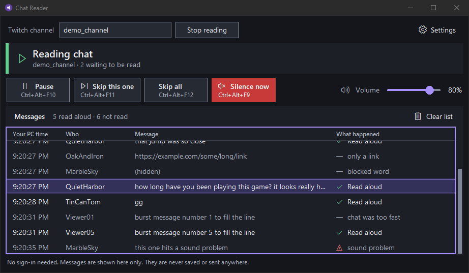
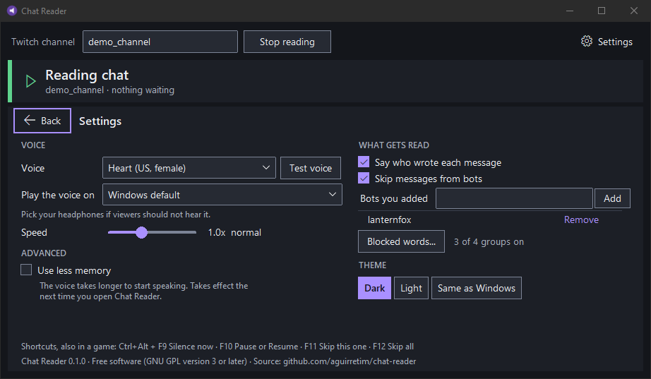

# Chat Reader

Reads a Twitch channel's chat aloud on Windows with a voice that runs on the PC (Kokoro-82M, ONNX, CPU only).
No sign-in, no paid service. Version 0.1.0.



Settings: voice, speaker, speed, which messages get read, and the colour theme.



The channel, names and messages in these pictures are made up (they come from `tools\window_check.py`).

## Run from source

```
git clone https://github.com/aguirretim/chat-reader
cd chat-reader
python -m venv .venv
.venv\Scripts\python -m pip install -r requirements.txt
.venv\Scripts\python run.py
```

Python 3.12 on Windows 10 or 11. On the first start the app downloads its two voice files (115 MB) by itself and
shows the progress; after that it works without the internet. They come from the kokoro-onnx release
`model-files-v1.0` and are checked against a size and SHA-256 pinned in `chatreader\voicefiles.py`:

| File | Bytes | SHA-256 |
|---|---|---|
| `kokoro-v1.0.int8.onnx` | 92,361,271 | `6e742170d309016e5891a994e1ce1559c702a2ccd0075e67ef7157974f6406cb` |
| `voices-v1.0.bin` | 28,214,398 | `bca610b8308e8d99f32e6fe4197e7ec01679264efed0cac9140fe9c29f1fbf7d` |

The packaged app (zip and installer) already contains them and makes no download.

## Test, build, check

```
.venv\Scripts\python -m pip install -r requirements-dev.txt
.venv\Scripts\python -m pytest -q             # no network, no sound
.venv\Scripts\python tools\mutation_check.py  # breaks each fix in turn; its test must go red
.venv\Scripts\python tools\window_check.py    # the real window with a stand-in controller, every state (shows for 20 s)
.venv\Scripts\python tools\audio_check.py     # opens every speaker with silence
.\build.ps1                                   # dist\ChatReader\ChatReader.exe and dist\ChatReader.zip
.\build.ps1 -Installer                        # the same, then dist\ChatReader-Setup-<version>.exe (see installer\README.md)
.\tools\installer_check.ps1                   # install, start, install over, uninstall, verify
.\tools\av_check.ps1 -Channel <busy channel>  # marked zip, shell extract, start, live chat, file fingerprint
```

## Layout

| Path | What |
|---|---|
| `chatreader\irc.py` | anonymous, read-only Twitch IRC; writes only CAP, NICK, JOIN, PONG |
| `chatreader\textclean\` | clean-up and safety step |
| `chatreader\speechqueue.py` | the waiting line: drop oldest, drop stale, drop repeats, remove deleted |
| `chatreader\controller.py` | chat -> clean-up -> line -> voice -> speaker; pause, skip, clear |
| `chatreader\voicefiles.py` | finds the voice files; downloads and checks them when they are missing |
| `chatreader\tts.py`, `audio.py`, `hotkeys.py`, `emotes.py`, `config.py` | voice, sound, hotkeys, emote names, settings |
| `chatreader\ui.py`, `widgets.py`, `viewmodel.py`, `theme.py`, `wordlist.py` | the window: layout, controls, what to show, colours, Blocked words |

Test switches (environment): `CR_NULL_AUDIO=1` silence instead of speech, `CR_START_MINIMIZED=1`,
`CR_AUTOCONNECT=<channel>`, `CR_AUTOTEST=1`, `CR_TIMING_LOG=<file>` (marks and counts only, never chat text),
`CR_DATA_DIR=<folder>` (settings somewhere other than `%APPDATA%\ChatReader`).

## Licence

Copyright (C) 2026 Tim Aguirre

This program is free software: you can redistribute it and/or modify it under the terms of the GNU General Public
License as published by the Free Software Foundation, either version 3 of the License, or (at your option) any
later version. It is distributed in the hope that it will be useful, but WITHOUT ANY WARRANTY; without even the
implied warranty of MERCHANTABILITY or FITNESS FOR A PARTICULAR PURPOSE. See the file `LICENSE`.

Why GPL: the app loads espeak-ng and phonemizer (both GPL-3.0-or-later) into its own process. "Or later" because
both of those are "or later" and no bundled part is "version 3 only". Every bundled component, its licence and
where its source is published: `tools\components.py` writes the list into `licenses\` at build time.
The Kokoro voice weights are Apache-2.0.